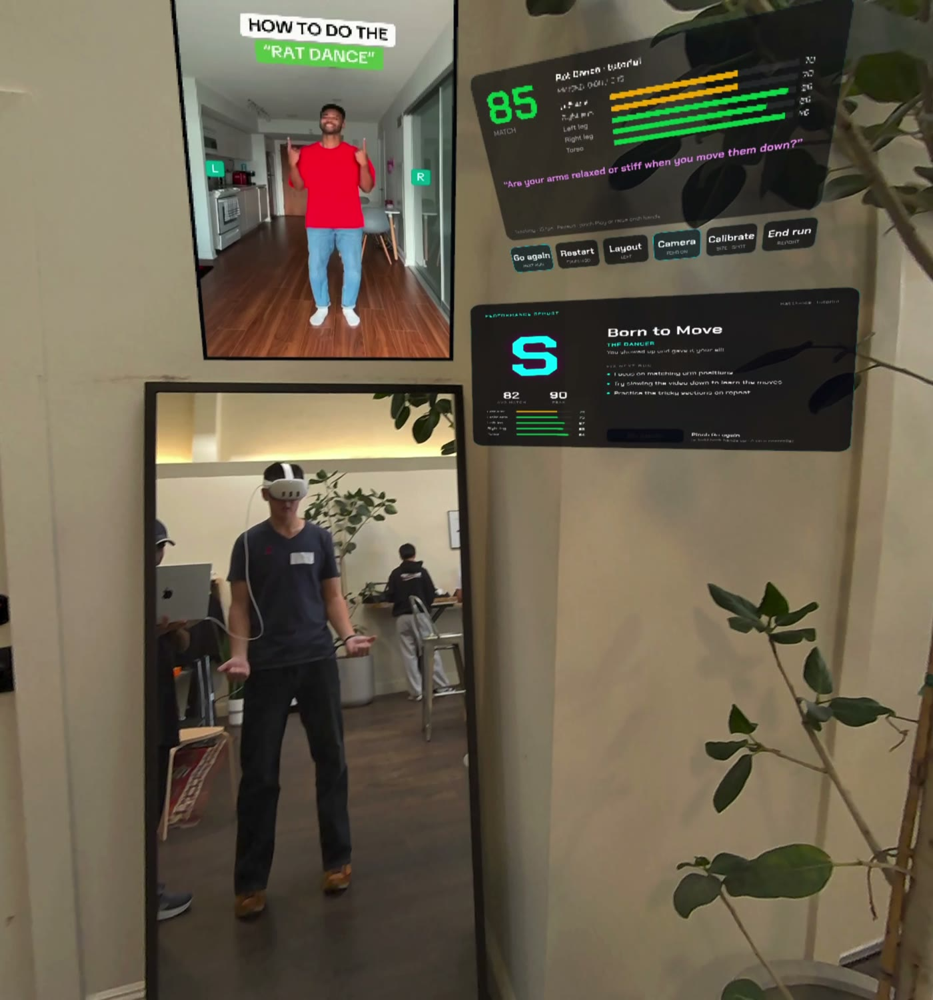
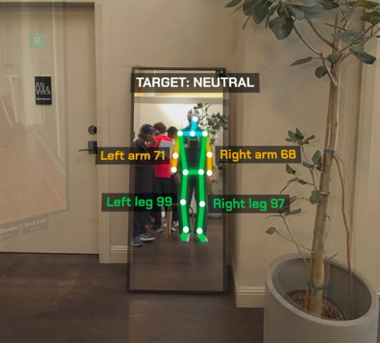

# VibeCheck

Demo video: https://youtu.be/oF5_4Gov9E8

**Real-time mixed-reality dance and fitness coaching, in your own mirror with Meta Quest 3.**




We built it in one day at the Fast Forward Hackathon, Vercel × Meta, on Oct 14 2026, for the VR Apps track.

| | |
| --- | --- |
| Mixed-reality mirror, Meta Quest 3 | https://vercel-ff-five.vercel.app/xr |
| 2D version, laptop or phone webcam | https://vercel-ff-five.vercel.app/ |
| Demo video | https://youtu.be/oF5_4Gov9E8 |

## What it does

After the pandemic and the explosion of TikTok dances, a lot of people learn moves from online videos. A video shows you the move. A mirror shows you yourself. Neither tells you what you're doing wrong.

With VibeCheck you put on a Meta Quest 3, stand in front of a real mirror, and pick a dance or workout video. The headset's camera watches your reflection, and VibeCheck draws your skeleton on top of it. Each limb gets a color and a score for how closely it matches the reference, and a dashed ghost of the instructor's pose sits on your body so you can see where each limb should go. The reference video floats beside the mirror. A voice coach tells you what to fix while you move, things like "drop your right shoulder, reach higher with the left arm". When the clip ends, you get a report card.

### Core features

- **Skeleton on your reflection.** Per-limb colors, score labels, the target posture, and the instructor's ghost pose, drawn where the mirror shows you.
- **Registration from the headset's own calibration.** The overlay uses the Quest camera's factory numbers: a 72.7° × 57.8° crop, an 11° downward tilt, and the lens offset from your eyes. VibeCheck pins each skeleton to the head pose from the moment the camera took that frame, and measures how far away your reflection is from your torso size, every frame. Fast moves still lag by about a tenth of a second, which is the camera plus the pose model.
- **Live voice coach.** Every few seconds Llama 4 Scout, through Vercel AI Gateway, turns the per-limb comparison into one spoken correction. The music drops to a quarter of its volume while the coach talks.
- **Report card.** After each full play-through you get a letter grade, your average and peak match, a per-limb breakdown, and a headline, persona and tips written by Llama 4 Maverick.
- **Hands only.** No controllers. Pinch the buttons under the HUD to play, restart, move the reference, show the camera feed, calibrate or end the run. Pinch **Go again** on the report card, or raise both hands to resume.
- **Reference library.** 15 curated clips, 9 dance and 6 workout, stored in Vercel Blob with pose timelines computed offline, so nothing waits on pose analysis. The 2D app also takes uploads and YouTube links.
- **Spatial layout.** The reference video goes left of, above or right of the mirror, and you can grab and move every panel.
- **Built for agents to drive.** `window.mirrorCoach.agent` has `help`, `status`, `log` and `do`. `scripts/quest-drive.mjs` drives a real Quest over USB, and `scripts/xr-verify.mjs` runs the whole flow headless in Meta's IWER emulator.

## Quick start

### Try it on a Quest 3

Nothing to install, no login.

1. Find a mirror. Full-length works best.
2. Stand 1.5 to 2 m from it, facing it.
3. In Quest Browser, open https://vercel-ff-five.vercel.app/xr, pick a clip, tap **Allow camera**, accept the prompt, and tap **Enter Mirror (MR)**.
4. Dance along. When the report card appears, pinch **Go again** for the next run.
5. To hand the headset over or pick another clip, leave XR. The setup screen comes back.

### Run it locally

You need Node 24+ and pnpm 10. YouTube ingest also needs a recent `yt-dlp` and `ffmpeg`.

```bash
vercel link                  # project vercel-ff (ask Aryan for access)
vercel env pull .env.local   # BLOB_READ_WRITE_TOKEN + VERCEL_OIDC_TOKEN (AI Gateway auth, re-pull after ~12 h)
pnpm install
pnpm build:xr                # builds xr/ into public/xr
PORT=3100 pnpm dev           # http://localhost:3100 (2D) and http://localhost:3100/xr (MR)
```

On localhost, `/xr` loads the IWER Quest 3 emulator by itself, so you can test with the laptop webcam and *Camera faces me*. For hot reload on the XR app, run `cd xr && npm run dev`. It starts IWSDK's Vite on https://localhost:8081 and proxies `/api` to `localhost:3100`. Read [`xr/AGENTS.md`](./xr/AGENTS.md) before you touch `xr/`, because IWSDK doesn't behave like plain Vite.

| Env var | Purpose |
| --- | --- |
| `BLOB_READ_WRITE_TOKEN` | Video library, pose timelines, uploads |
| `VERCEL_OIDC_TOKEN` | AI Gateway and Sandbox auth. Automatic on Vercel, `vercel env pull` locally |
| `AI_GATEWAY_API_KEY` | Optional, another way to auth with the Gateway |
| `YTDLP_PROXY` / `YTDLP_COOKIES` | Optional, gets Vercel Sandbox past YouTube's bot check |
| `SAM2_ENDPOINT_URL` | Optional, local only. Dancer segmentation in the 2D app, `services/sam2` |

Never commit `.env*`, credit codes or tokens.

## How scoring works

About 15 times a second in the headset, VibeCheck compares your pose with the reference frame at the video's current time.

| Signal | Weight | Source |
| --- | --- | --- |
| Per-limb pose match | 80% | Joint angles and positions of each limb against the closest reference frame, in mirror space, so you follow the video the way you'd follow a dance-studio mirror |
| Body heuristics | 20% | Arm height, symmetry, motion energy, torso lean |

An EMA with alpha 0.15 smooths the score. A mirror flips left and right, so the labels and the voice switch back to your real left and right. The 2D app adds a third signal: every few seconds Llama 4 Scout compares a reference frame with a webcam frame.

### Report card grades

| Grade | Average match |
| --- | --- |
| S | 78+ |
| A | 62+ |
| B | 45+ |
| C | 30+ |
| D | below 30 |

The grade, averages and limb bars come straight from the run's data, so they show up right away. The headline, persona and tips arrive from `/api/report` a few seconds later.

## Architecture

```
                 ┌────────────────── Next.js on Vercel ───────────────────┐
 Laptop (2D) ──▶ │ /            2D coach (webcam + reference side by side) │
 Quest (MR)  ──▶ │ /xr          IWSDK mirror app (built from xr/)          │
                 │ /api/library   list videos        (Vercel Blob)         │
                 │ /api/download  YouTube → Blob     (local yt-dlp │ Sandbox)│
                 │ /api/upload    browser → Blob token (clips, recordings) │
                 │ /api/video/:id 307 → Blob mp4 (CORS ok, byte ranges)    │
                 │ /api/poses/:id dense reference pose timeline (Blob)     │
                 │ /api/coach     coach line + TTS mp3 ─┐                  │
                 │ /api/score     vision pose match    ─┼─▶ AI Gateway     │
                 │ /api/report    end-of-session card  ─┘                  │
                 └─────────────────────────────────────────────────────────┘

Quest passthrough camera (getUserMedia) → MediaPipe Pose in the browser (~15 Hz)
  → CoachEngine: per-limb match vs. the reference timeline → score, labels, ghost pose
  → overlay plane at the reflection's depth, pinned to the head pose at capture
  → /api/coach every 3.5–5.5 s → spoken line (music ducks to 25%)
  → clip wraps → report card → /api/report
```

The setup screen does its work in 2D, before XR starts. It loads the clip, the clip's pose timeline and the live pose model, and it asks for the camera there because Quest Browser won't grant camera access inside an immersive session. Tapping **Enter** requests the XR session inside the tap itself. From then on `MirrorSystem` in `xr/src/mirror-system.ts` runs every XR frame. It sends camera frames to MediaPipe, refreshes the video panels and places the overlay.

### Model routing

Every model call goes through `app/lib/ai.ts`, and each one has fallbacks on the Gateway side.

| Task | Primary | Fallbacks |
| --- | --- | --- |
| Coach line, every ~4 s | `meta/llama-4-scout` | `google/gemini-3.5-flash-lite`, `openai/gpt-4o-mini` |
| Vision pose match, 2D app | `meta/llama-4-scout` | same |
| Voice | `openai/tts-1` | `google/gemini-3.8-flash-lite-tts` |
| Report card | `meta/llama-4-maverick` | `google/gemini-3.5-flash`, `openai/gpt-4o-mini` |
| Dance vs. fitness | `meta/llama-3.1-8b` | `google/gemini-3.5-flash-lite` |

## Tech stack

- Meta Immersive Web SDK (IWSDK) and Three.js, running WebXR `immersive-ar` with passthrough and hand tracking
- The Quest passthrough camera, read through `getUserMedia`
- MediaPipe Pose in the browser for live tracking, and MediaPipe PoseLandmarker heavy offline for the library
- AI SDK through Vercel AI Gateway: Llama 4 Scout and Maverick, OpenAI TTS, each with fallbacks
- Next.js App Router, React, TypeScript and Tailwind CSS, hosted on Vercel
- Vercel Blob for videos, pose timelines and recordings
- yt-dlp and ffmpeg for video ingest, on a laptop or in Vercel Sandbox

## Development

### Reference library

[`scripts/library/clips.json`](./scripts/library/clips.json) lists the curated clips. `id` is the YouTube id, and `start`/`end` optionally trim the clip in seconds. `scripts/library/ingest.mjs` downloads each clip, re-encodes it to 540p, runs `poses.py` with MediaPipe PoseLandmarker heavy at a 0.25 s step, and uploads the mp4, its metadata and the timeline to Blob.

```bash
node --env-file=.env.local scripts/library/ingest.mjs                 # all clips (~5 min)
node --env-file=.env.local scripts/library/ingest.mjs <id> [<id>...]  # add or redo some
node scripts/library/ingest.mjs --dry-run <id>                        # check quality, no upload
```

It needs `yt-dlp`, `ffmpeg` and `uv`. Pick clips with one performer facing a fixed camera and no cuts, and aim for `detected` of 0.9 or more. In the 2D app, **Library → + Upload clip** or a YouTube URL adds a clip that everyone sees.

| Mode | Clip | Credit (YouTube) |
| --- | --- | --- |
| dance | Rat Dance · tutorial | Bizzy Boom |
| dance | Macarena · step by step | wikiHow |
| dance | Greedy (Tate McRae) · beginner choreo | Tiana Shern |
| dance | The Griddy · tutorial | 1NINEFIVE |
| dance | The Floss · step by step | wikiHow |
| dance | Zumba warm-ups: Let's Go, Aguita, Marimba | Z-Therapy Holly Corrente |
| dance | Sharara · easy choreo | Boomoves |
| gym | High knees · 1 min | Olena |
| gym | Jumping jacks · 1 min | GVSU Human Resources |
| gym | Bicep curls · 1 min | GVSU Human Resources |
| gym | Squats · 20 reps | Roberta's Gym Love |
| gym | Wide squats · 1 min | WatchFit |
| gym | Shadow boxing · 1 min | ABOVEBOXING |

These are other people's YouTube videos. We use them as demo references for a hackathon prototype and credit them above, but they aren't ours to redistribute. Swap in clips we record or license before any public launch.

### Drive a real Quest from the laptop

Turn on developer mode and plug the headset in over USB. `scripts/quest-drive.mjs` then talks to Quest Browser over ADB and DevTools.

```bash
node scripts/quest-drive.mjs open "https://vercel-ff-five.vercel.app/xr?beacon=1&v=FILJpZiAFo0"   # open on the headset
TARGET=21 node scripts/quest-drive.mjs state      # mirrorCoach.agent.status(): fps, scores, coach line, calibration
node scripts/quest-drive.mjs do selectClip '{"id":"FILJpZiAFo0"}'   # any agent action: enter, play, finishRun, calibrate…
node scripts/quest-drive.mjs view                 # what the wearer sees (passthrough + XR)
node scripts/quest-drive.mjs cast                 # wireless cast over Wi-Fi ADB (needs a network that allows it)
```

It uses Meta Quest Developer Hub's `adb` when that's installed. Only one browser tab can hold the passthrough camera at a time.

### Verify XR without a headset

```bash
PORT=3100 pnpm dev & pnpm build:xr
node scripts/xr-verify.mjs                    # setup → MR → coaching → run end → report card → Go again
node scripts/xr-verify.mjs --base https://vercel-ff-git-<branch>-aryan-keluskars-projects.vercel.app
```

The verifier runs `/xr` in headless Chromium with the IWER emulator and a fake camera playing a dancer. It prints PASS or FAIL for each step and saves screenshots to `.tools/xr-verify/`. Run it before you push any XR change.

### Deploying

A push to `master` deploys production at https://vercel-ff-five.vercel.app. Every other branch gets a public preview at `https://vercel-ff-git-<branch>-aryan-keluskars-projects.vercel.app`, and previews open on the Quest too. Each build runs `pnpm build`, which typechecks and builds `xr/` and then runs `next build`. Vercel blocks commits from GitHub accounts outside the Vercel team. If production shows "Deployment was blocked", Aryan pushes an empty commit to redeploy.

### Contributing, humans and agents

- Before you claim or start a TODO, check the other branches. Run `git fetch --all --prune`, `git branch -r --sort=-committerdate`, `git log --oneline master..origin/<branch>` and `gh pr list`. If a branch already claims the TODO or touches its files, pick something else. Push your claim straight to `master` so everyone sees it.
- Pull before you push, and run `pnpm build` first. XR changes also need `node scripts/xr-verify.mjs`.
- Agents drive `/xr` through `mirrorCoach.agent`, described in [`AGENTS.md`](./AGENTS.md#working-on-the-xr-app-as-an-agent-xr). New XR behavior gets a registered action and a verifier check.
- The 2D app and `xr/` share logic in `app/lib` and `app/shared`. Don't fork it.

### Known gotchas

- Grant camera permission on the 2D setup screen. Asking for it inside the XR session ends the session.
- Request the XR session inside the Enter tap, before any `await`, or the browser refuses it.
- YouTube blocks datacenter IPs, Vercel Sandbox included. Ingest from a laptop or set a proxy.
- The emulator fakes the Quest user agent, so don't use the user agent to detect a headset.
- A hidden tab, or a headset nobody is wearing, stops `requestAnimationFrame`. Setup and tracking wait until someone looks at the page.

Our hackathon working notes, with the status table, TODO list, demo plan and submission copy, are in [`docs/hackathon.md`](./docs/hackathon.md).

## Team

| Name | GitHub |
| --- | --- |
| Aryan Keluskar | [@aryankeluskar](https://github.com/aryankeluskar) |
| Ali Sasanian | [@Gond-ul](https://github.com/Gond-ul) |
| Lucas Masen | [@lucasmasen](https://github.com/lucasmasen) |
| Cristal Jiang | [@cristalj](https://github.com/cristalj) |
